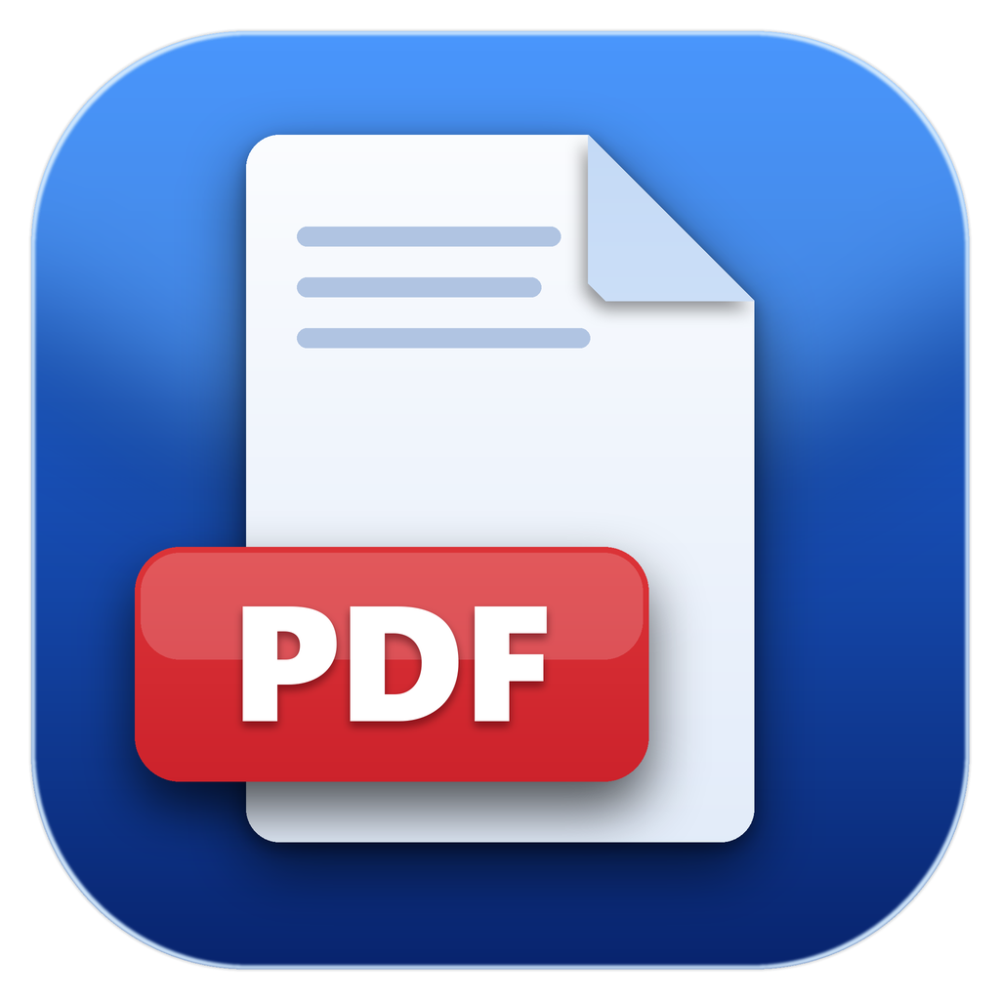

<p align="center">
  
</p>

<h1 align="center">PDF Reader</h1>

<p align="center">
  A fast, simple and good-looking PDF reader for Windows 11.<br />
  WinUI 3 · .NET 10 · Windows App SDK
</p>

---

## Features

- **Open PDFs your way**: file picker (`Ctrl+O`), drag and drop, double-click, or *Open with → PDF Reader*.
- **Continuous reading**: pages are rendered only when needed, so documents with thousands of pages open quickly.
- **Zoom**: `Ctrl` + mouse wheel, `Ctrl` + `+` / `-`, `Ctrl+0` (fit width), "Fit page", and 50–300% presets (up to 500%).
- **Page navigation**: type a page number; `Home` / `End` / `PageUp` / `PageDown` / arrow keys / `Space` all work.
- **Password-protected PDFs**: you are asked for the password when opening.
- **Library**: *Recent*, *All PDFs* and *Favorites*; star a document to keep it handy.
- **Remembers where you stopped**: a document reopens on the last page you read.
- **Three languages**: English, Uzbek (O‘zbekcha) and Russian (Русский). Switch in Settings and the whole app updates instantly, with no restart.
- **Remembers your window**: size, position, maximized and full screen state are restored on the next start, even after a crash.
- **Full screen**: `F11` (or the toolbar / Settings); `Esc` leaves full screen.
- **Light and dark themes** (in Settings).
- **Updates**: the app checks GitHub Releases for a newer version and can download and install it for you (Settings → About).
- **Private by design**: documents are processed locally and nothing is uploaded.

Not available yet: text search and printing.

## Settings

Open **Settings** from the sidebar. Changes apply immediately and are saved automatically.

| Section | What you can do |
| --- | --- |
| **Appearance** | Follow Windows, or force the light or dark theme. |
| **Language** | Choose English, O‘zbekcha or Русский. On first start the app uses your Windows display language if it is one of these, otherwise English. |
| **Window & Display** | Turn full screen on or off, choose whether the window size, position and full screen state are remembered, and reset the window layout. |
| **About** | Current version, *Check for updates*, and automatic update checks. |

## Keyboard shortcuts

| Keys | Action |
| --- | --- |
| `Ctrl+O` | Open a PDF |
| `F11` | Toggle full screen |
| `Esc` | Leave full screen |
| `Ctrl` + mouse wheel, `Ctrl` + `+` / `-` | Zoom in / out |
| `Ctrl+0` | Fit width |
| `Home` / `End` | First / last page |
| `PageUp` / `PageDown` / `Space` | Scroll one screen |

## Installation

Download the latest version from the [Releases](../../releases) page:

| File | Description |
| --- | --- |
| `PDFReader-Setup-<version>.exe` | Installer (recommended). No administrator rights required. |
| `PDFReader-<version>-win-x64-portable.zip` | No installation: extract the archive and run `PdfReader.exe`. |

Requirements: Windows 10 (1809) or newer, 64-bit. No separate .NET or runtime installation is needed.

> Windows 11 does not allow apps to silently change the default PDF handler. To always open PDFs with this app:
> right-click a PDF → **Open with** → **Choose another app** → **PDF Reader** → **Always**.

## Building from source

You will need:

- Windows 10/11
- [.NET 10 SDK](https://dotnet.microsoft.com/download)
- *(for the installer)* [Inno Setup 6](https://jrsoftware.org/isdl.php)

```powershell
# build
dotnet build -p:Platform=x64

# run
dotnet run -p:Platform=x64

# run and open a PDF
.\bin\x64\Debug\net10.0-windows10.0.26100.0\win-x64\PdfReader.exe "C:\path\file.pdf"
```

### Tests

```powershell
dotnet test tests\PdfReader.Tests
```

The tests cover the UI-independent logic: language selection, the translation files (every key present in all
three languages, matching placeholders, no unused or missing keys), window placement and settings persistence,
and update-release parsing.

### Adding or changing text

All user-facing text lives in `Localization/Strings/{en,uz,ru}.json`. Use the key in XAML
(`loc:Loc.Text="settings.title"`) or in code (`Loc.Get("settings.title")`) and add it to all three files;
the tests fail if a key is missing, unused or untranslated.

To create the installer and the portable package, see [docs/PACKAGING.md](docs/PACKAGING.md).

## Project structure

```
.
├── PdfReader.csproj        # project (unpackaged, self-contained WinUI 3)
├── App.xaml(.cs)           # entry point, DI container, launch arguments
├── MainWindow.xaml(.cs)    # window, sidebar, drag and drop
├── Views/                  # HomePage, LibraryPage, SettingsPage, ViewerPage (the PDF viewer)
├── ViewModels/             # MVVM (CommunityToolkit.Mvvm)
├── Services/               # opening files, navigation, theme, settings, library
├── Database/               # SQLite (recent files, favorites, last page)
├── Core/                   # UI-independent logic: settings file, window placement, release parsing
├── Localization/           # Loc (XAML helper), language list, string catalog, Strings/*.json
├── Models/ · Converters/
├── Assets/                 # icons
├── tests/PdfReader.Tests/  # xUnit tests
├── installer/              # Inno Setup script and build.ps1
└── docs/                   # documentation
```

PDF rendering uses Windows' built-in `Windows.Data.Pdf`, so no extra native libraries are required.

User data (database, `settings.json`, logs) is stored in `%LOCALAPPDATA%\PdfReader`.

## Icon

The icon is drawn by `installer/make_icon.py` (requires Pillow):

```powershell
pip install pillow
python installer\make_icon.py
```
